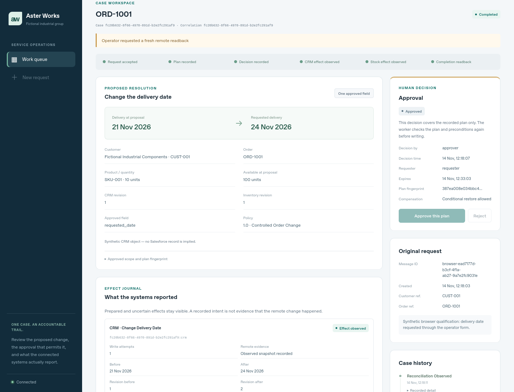

# CRM Order Workflow Agent

**A delivery-date exception with an exact approval, durable execution and an observed business result.**

I built this project around a fictional industrial customer-service team. An operator requests a delivery-date change, the workflow resolves the customer and order, checks stock and prepares a plan. A separate approver authorizes that exact change. Temporal coordinates the CRM update and inventory reservation, then rereads both systems. Uncertain writes are reconciled through stable effect identities; compensation respects later human changes.

**[Browse the implementation and run guide](https://github.com/mehdisafer/crm-order-workflow-agent/tree/feat/p06-controlled-order-workflow)** · **[Execution evidence](https://github.com/mehdisafer/crm-order-workflow-agent/blob/c5b1fa9286775f47adc2dbfe94f710e4eb26afd9/docs/evidence/README.md)** · **[Implementation PR #2](https://github.com/mehdisafer/crm-order-workflow-agent/pull/2)**

## Actual operator view



This capture comes from the real local interface, using original synthetic data. The browser submitted a request, switched to a distinct approver, waited for Temporal completion and requested a fresh readback. [Desktop and narrow-viewport observations](https://github.com/mehdisafer/crm-order-workflow-agent/blob/c5b1fa9286775f47adc2dbfe94f710e4eb26afd9/docs/evidence/firefox-ui/README.md) include original failures, corrected runs and their exact limits.

## What has been exercised

| Area | Observed evidence |
| --- | --- |
| Business policies and API | 91 local tests passed with no failures or skips, including real Temporal profiles |
| Durable recovery | Temporal history replay, abrupt worker exit after a persistent effect, and server-history restart |
| Operator interface | Actual Firefox desktop intake/approval/readback; six completed-case desktop/narrow-viewport captures with zero relevant browser errors |
| n8n peripheral trigger | Actual 2.47.5 import and authenticated trigger; missing/wrong credentials refused, duplicate maps to one case, distinct approval and completed Temporal result |
| MuleSoft source package | Maven build succeeded for target 4.9.24, with resolved connectors and retained configuration warnings |
| Earlier bounded exercises | 24 synthetic cases with two worker processes and zero duplicate effects; isolated PostgreSQL logical restore |

Salesforce and the running Mule server still require authorized deployment and actual-provider acceptance. The reference Docker stack and CI Chromium profile have not executed: GitHub's jobs failed before runner allocation. These open items are tracked in [issue #1](https://github.com/mehdisafer/crm-order-workflow-agent/issues/1) and the [acceptance record](https://github.com/mehdisafer/crm-order-workflow-agent/blob/feat/p06-controlled-order-workflow/docs/acceptance.md).

## Run the local candidate

The implementation is on the candidate branch while PR #2 remains open. This default-branch README provides direct access to that code; merging this presentation does not merge the application or satisfy its CI gate.

Requirements: Python 3.12 and [uv](https://docs.astral.sh/uv/).

```bash
git clone --branch feat/p06-controlled-order-workflow https://github.com/mehdisafer/crm-order-workflow-agent.git
cd crm-order-workflow-agent
uv sync --locked
uv run --locked python -m crm_workflow.cli smoke
```

The smoke starts an isolated real Temporal service, runs the synthetic saga with a distinct approver, verifies both resulting states and writes `evidence-local/smoke.json`. The first run downloads the official Temporal test-server binary if it is not cached. It needs no Salesforce credentials, external LLM or paid account.

For interactive operation, see the [operator guide](https://github.com/mehdisafer/crm-order-workflow-agent/blob/feat/p06-controlled-order-workflow/docs/operator-guide.md). [Architecture](https://github.com/mehdisafer/crm-order-workflow-agent/blob/feat/p06-controlled-order-workflow/docs/architecture.md), [operations and restore](https://github.com/mehdisafer/crm-order-workflow-agent/blob/feat/p06-controlled-order-workflow/docs/operations.md) and [provider installation](https://github.com/mehdisafer/crm-order-workflow-agent/blob/feat/p06-controlled-order-workflow/docs/vendor-integration.md) describe the system boundaries and reproduction steps.

## Publication and licence

Public source publication is authorized. The repository licence remains undecided and requires the maintainer's selection; third-party software retains its own terms. The prepared 0.1.0-rc.1 candidate is not a production deployment or full Salesforce/MuleSoft acceptance. No public release or version tag is asserted here.
