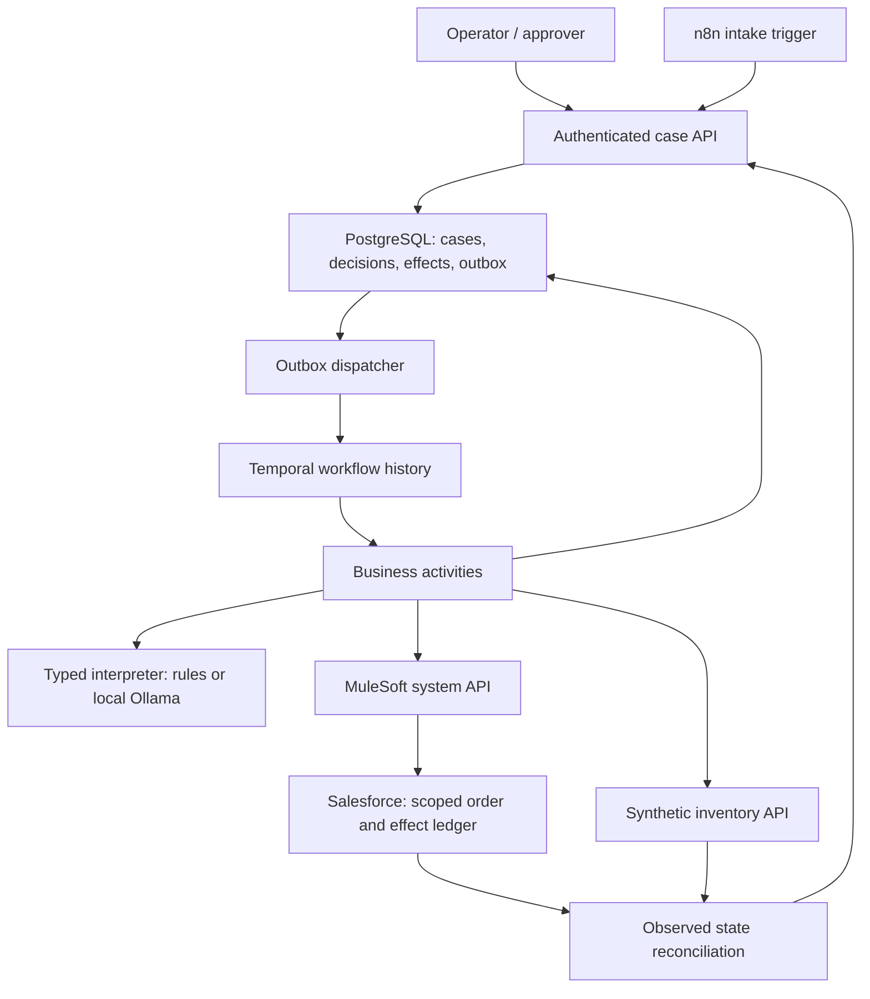

# CRM Order Workflow Agent

**An order exception should end with an observed business result, a safe compensation, or a clear escalation.**

I built this project around a fictional industrial customer-service team. An operator requests a delivery-date change, the workflow resolves the customer and order, checks stock, prepares an exact plan and waits for a separate approver. It then changes the CRM date, reserves inventory and rereads both systems. If the reservation fails, it can restore the original date only when no newer CRM change has occurred.

The engineering focus is durable execution, trustworthy approvals and honest recovery from uncertain remote writes. No payments or real commercial commitments are in scope. All fixtures are synthetic.

## What works, and what remains open

| Area | Current evidence |
| --- | --- |
| Operator API and case view | Actual Firefox desktop form, separate approval, Temporal completion and readback exercised; completed-case desktop and narrow-viewport screenshots retained |
| Temporal workflow | Real Temporal execution, history replay, process crash recovery and persistent server restart exercised |
| Transactional store and outbox | SQLite local profile and isolated PostgreSQL business/restore exercises executed |
| Local CRM and ERP | Explicitly synthetic implementations; duplicate messages, uncertain responses and compensation conflicts tested |
| Salesforce through MuleSoft | Real adapter, Apex/metadata, permissions and live acceptance harness prepared; Mule package built for 4.9.24 with resolved dependencies and retained warnings; **no tenant/runtime execution yet** |
| n8n | Actual 2.47.5 import and authenticated trigger exercised through Temporal completion; missing/wrong credentials refused, duplicate delivery produces one case |
| Container reference | Source prepared; GitHub jobs failed before runner allocation, so container qualification remains open. The local Firefox observation is a separate profile; see [the evidence index](docs/evidence/README.md) |
| Publication | Public source publication is authorized; the last observed GitHub visibility is still private, and PR #2 has not been merged. The repository licence remains undecided; see [publication status](docs/publication.md) |

The local demonstration does **not** satisfy Salesforce/MuleSoft acceptance. [Issue #1](https://github.com/mehdisafer/crm-order-workflow-agent/issues/1) stays open for that milestone and the other documented gates. Detailed evidence and limits are in [acceptance.md](docs/acceptance.md).

## Run the smallest real workflow

Requirements: Python 3.12 and [uv](https://docs.astral.sh/uv/). The first smoke run downloads the official Temporal CLI test-server binary if it is not cached. The candidate is on the reviewed implementation branch in [PR #2](https://github.com/mehdisafer/crm-order-workflow-agent/pull/2), while the CI gate remains open.

```bash
git clone --branch feat/p06-controlled-order-workflow https://github.com/mehdisafer/crm-order-workflow-agent.git
cd crm-order-workflow-agent
uv sync --locked
uv run --locked python -m crm_workflow.cli smoke
```

This starts an isolated real Temporal service, executes the full synthetic business saga, approves with a distinct identity, rereads both systems and writes `evidence-local/smoke.json`. It shuts down its temporary services. It does not start a vendor account or send a notification to anyone.

## Use the operator view

Initialize once:

```bash
uv run --locked python -m crm_workflow.cli init-demo
```

This creates a local database and random requester, approver and operator tokens in `.local/tokens.json`. Only token hashes are loaded by the API. The command refuses to overwrite existing identities.

With the [Temporal CLI](https://docs.temporal.io/cli) installed, run these in three terminals:

```bash
temporal server start-dev --db-filename .local/temporal-history.db
```

```bash
uv run --locked python -m crm_workflow.worker
```

```bash
uv run --locked uvicorn crm_workflow.api:create_app --factory --host 127.0.0.1 --port 8000 --no-access-log
```

Open `http://127.0.0.1:8000`. Sign in with the requester token, create a request for `CUST-001` / `ORD-1001`, and choose a future delivery date different from the order's current date. Switch to the separate approver token to inspect and approve the bound plan. Tokens stay in browser memory and disappear on refresh or sign-out.

The case view shows the proposal, decision, actual effect journal, CRM object link, event timeline and fresh reconciliation result. A later human change is shown as drift even if the historical workflow completed successfully. See the [operator guide](docs/operator-guide.md).


This is an actual local Firefox capture, using fictional data. The browser submitted the request, switched to a distinct approver, waited for the real Temporal workflow and requested a fresh readback. [The browser evidence](docs/evidence/firefox-ui/README.md) includes the mobile view, original failures and exact limits. Automated fixture interactions do not measure real human response time.

For a container reference with PostgreSQL, persistent Temporal history and external secret files, follow [operations.md](docs/operations.md). Ports bind to loopback. Optional ERP HTTP, n8n and monitoring profiles are explicit.

## Business and recovery guarantees in scope

- **Resolve, never guess.** Unknown customers, ambiguous references, nonexistent orders, missing information and contradictory requests require clarification. Insufficient stock escalates.
- **Approve an exact change.** The plan binds tenant, requester, customer, order, field, before-version, stock-version, target date, risk, policy version and expiry. A model cannot grant itself permissions or enlarge that scope.
- **Check again before writing.** CRM and stock are reread immediately before the CRM mutation; each target atomically checks its own revision. A changed snapshot invalidates the approval.
- **Reconcile an uncertain write.** The immutable effect key is looked up before any repeat. A missing receipt while a request may still be running does not prove failure.
- **Compensate conditionally.** A later human edit prevents restoration. An unknown stock outcome blocks CRM compensation until the reservation is resolved. Original and compensating effects remain visible.
- **Bound recovery work.** Durable API-call and write budgets, per-system shared concurrency leases, a circuit breaker, `Retry-After`, Temporal activity deadlines and an outbox failure queue limit repeated attempts.

The local implementations prove these behaviours for their own transactions. The [provider acceptance procedure](docs/vendor-integration.md) separately verifies Salesforce/MuleSoft behaviour against actual APIs.

## Architecture



Temporal is the workflow authority. The database is the business record and durable dispatch boundary. MuleSoft owns a narrow Salesforce system API; n8n owns the peripheral trigger. There is no second saga in either. The optional local model only extracts typed intent from minimized request fields. The default profile requires no model download or external LLM API.

[Architecture and decisions](docs/architecture.md) explain the transaction boundaries, retry owner, approval races, versioning and deployment limits.

## Verification profiles

```bash
# Core policy, API, source-system and contract tests
uv run --locked pytest -m "not temporal and not vendor and not load"

# Real Temporal: durable approval, replay, killed worker and server restart
RUN_TEMPORAL_TESTS=1 uv run --locked pytest -m temporal

# Bounded isolated load, two actual worker processes, no provider calls
uv run --locked python scripts/load_profile.py --cases 24 --workers 2 --concurrency 4

# Optional isolated PostgreSQL transaction + logical restore exercise
uv run --locked --with pgserver==0.1.4 python scripts/postgres_profile.py --output evidence-local/postgres-restore.json

# Source invariants, separate from the recorded Maven package build
uv run --locked python integrations/vendor_validation/check_sources.py
```

On PowerShell, set `$env:RUN_TEMPORAL_TESTS = '1'` before the Temporal command. `pgserver` is an optional test-binary helper, not a production dependency or the reference container version. The recorded load measured a small synthetic workload on one host; it is not a vendor scalability claim.

## Salesforce, MuleSoft and n8n

The Salesforce integration uses a dedicated `P06_Order__c` custom object and an immutable `P06_Effect__c` ledger, plus standard Account. It does not assume access to standard Order, Commerce, CPQ or any particular edition entitlement. An actual org preflight must confirm custom objects, Apex, API access, users and permissions.

The repository includes deployment source, an HTTPS Mule system API, an inactive n8n export and a real-provider acceptance harness. That harness drives the running API and Temporal, deliberately loses a response **after a real successful upstream write**, checks the Salesforce ledger, exercises a real reader refusal and rejects a stale approval. It needs an explicitly authorized sandbox/Developer Edition, separate provider identities and an existing licensed Mule runtime. [Installation and qualification](docs/vendor-integration.md) provides the steps and effective version/permission checks.

The [Mule package build](docs/evidence/mule-build-20261114/README.md) resolved the exact HTTP and OAuth connector artifacts and generated an application archive. External configuration, TLS and stream-validation warnings remain visible. Packaging does not establish deployed OAuth behavior, Salesforce permissions or the required real business result.

The [n8n qualification](integrations/n8n/README.md) imported the exact inactive export into a disposable 2.47.5 instance, bound separate inbound and requester credentials outside Git, then observed the real webhook-to-case-to-Temporal path. Its final readback used the synthetic CRM and separate HTTP ERP. This qualifies the peripheral trigger in that local profile; it does not extend provider acceptance.

## Repository map

| Path | Purpose |
| --- | --- |
| `src/crm_workflow/` | Domain policy, transaction store, adapters, Temporal runtime, API and operator UI |
| `contracts/v1/` | Versioned JSON schemas, OpenAPI and event/effect contracts |
| `config/` | Validated profiles, fixed policy selection and environment overrides |
| `integrations/` | Salesforce metadata/Apex, MuleSoft application, n8n export and real-provider checks |
| `tests/` | Business, security, HTTP, concurrency and actual Temporal recovery tests |
| `scripts/` | Bounded load, PostgreSQL restore and evidence utilities |
| `deploy/` | Container reference, secret preparation, service limits, monitoring and source/history scan |
| `docs/` | Architecture, operator guide, incident/restore procedures, acceptance, evidence and release notes |

## Scope, sources and licence

All application code and fixtures were created for this repository. No client code, customer records, P01 source or personal workstation data was imported. No real messages, payments, subscriptions, public service exposure or repository visibility change are part of the demo.

Python dependencies are pinned with hashes in `uv.lock`. The [component inventory](docs/evidence/components.json) records observed package metadata; [vendor sources](docs/vendor-sources.md) identify vendor terms and version references. These are inventories, not security or legal certifications.

Public source publication is the intended distribution. The repository licence is **pending explicit maintainer selection**, so no open-source licence is inferred from dependency licences. Third-party software retains its own terms. [Publication status](docs/publication.md) separates the visibility setting, delivery to the default branch, licence decision and actual-provider acceptance.
